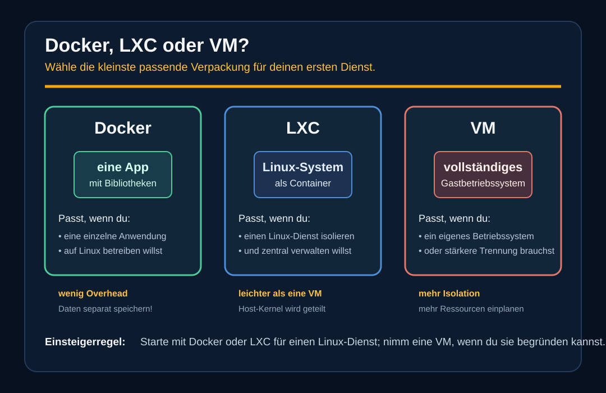
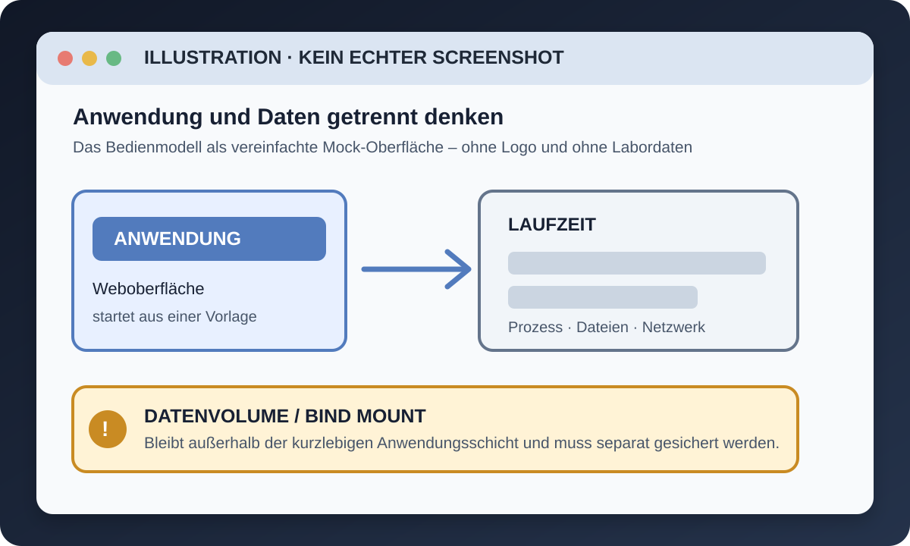

+++
title = "Docker, LXC oder VM? Die Einsteigerentscheidung vor dem ersten Dienst"
description = "Docker, LXC oder VM – woran erkennst du, welche Virtualisierung für deinen ersten Homelab-Dienst passt, ohne Benchmark oder Lab-Test."
slug = "docker-lxc-oder-vm-einsteigerentscheidung"
draft = true
robotsNoIndex = true
noindex = true
preview = true
draft_banner = true
hideMeta = true
ShowShareButtons = false
ShowPostNavLinks = false
comments = false
stage = "REVIEWER_PASS_PREVIEW_VALIDATION"
preview_content_type = "article_draft"
publish_eligible = false
approved_for_publish = false
content_state = "reviewer_pass_preview_validation"
affiliate = "NONE"
source_task = "t_e61b8900"

[sitemap]
  exclude = true

[workflow]
  content_state = "reviewer_pass"
  editorial_status = "pass"
  technical_status = "pass"
  visual_status = "pass"
  seo_status = "pass"
+++

# Docker, LXC oder VM? Die Einsteigerentscheidung vor dem ersten Dienst

Du willst im Homelab deinen ersten Dienst starten und stolperst sofort über drei Begriffe: Docker, LXC und VM. Alle drei können Software getrennt vom restlichen System ausführen. Sie verpacken aber nicht dasselbe.

Die kurze Entscheidungsregel:

- **Docker**, wenn du vor allem eine Anwendung betreiben willst.
- **LXC**, wenn du ein kleines Linux-System mit eigenen Diensten verwalten willst.
- **VM**, wenn du ein vollständiges Gastbetriebssystem, einen eigenen Kernel oder eine stärkere Trennung vom Host brauchst.

Für ein erstes Projekt musst du nicht die perfekte Plattform für alle späteren Dienste finden. Wähle die kleinste Variante, die dein aktuelles Ziel erfüllt. Entscheidend ist außerdem, dass du von Anfang an weißt, wo Konfiguration und Nutzdaten liegen.

*Bildnachweis: deterministische lokale MATMAKSA-Grafik aus dem Content-Brief, selbst erstellt, ohne externe Pixel oder Logos. Original: `01-docker-lxc-vm-entscheidung.svg`; SHA256: `27c77e5367f2eb8097a8d51a2f1b3813868e1bc708199ea395331ef84ad193da`.*

## Fünf Begriffe, die du auseinanderhalten solltest

Der **Host** ist der Rechner beziehungsweise das Betriebssystem, das deine virtuelle Umgebung bereitstellt. Ein **Gast** ist das darin ausgeführte System. Bei einer VM ist dieser Gast ein vollständiges Betriebssystem mit eigenem Kernel. Docker- und LXC-Container teilen sich dagegen den Kernel des Systems, auf dem sie laufen.[1]

Die Proxmox-Einordnung zu Systemcontainern beruht auf der Proxmox Container Toolkit Dokumentation.[3]

Eine **Anwendung** ist dein eigentlicher Dienst, etwa eine Weboberfläche oder eine Datenbank. Ein **Container** kapselt Prozesse und deren Dateien. Das **Image** ist bei Docker die unveränderliche Vorlage, aus der ein Container startet. Schreibvorgänge landen zunächst in einer beschreibbaren Container-Schicht. Löschst du den Container, verschwinden Daten in dieser Schicht mit ihm. Dauerhafte Daten gehören deshalb in ein Volume oder einen Bind Mount außerhalb dieser Schicht.[1]

Diese Unterscheidung verhindert einen typischen Denkfehler: Ein Docker-Image ist kein kleines Betriebssystem-Backup. Es ist eine Vorlage für die Anwendung.

## Docker: Die Anwendung steht im Mittelpunkt

Ein Docker-Container ist aus Sicht des Hosts ein isolierter Prozess. Er bekommt eine eigene Sicht auf Dateien, Prozesse, Netzwerk und Hostnamen. Das Image bringt die Dateien, Laufzeitbibliotheken, den Anwendungscode und den Startbefehl mit.[1]

Das passt gut, wenn du eine konkrete Anwendung betreiben möchtest und dafür bereits ein Linux-System zur Verfügung steht. Bei einer Anwendung mit mehreren Bestandteilen startest du häufig mehrere Container, zum Beispiel einen für die Webanwendung und einen für die Datenbank. Jeder Bestandteil lässt sich einzeln ersetzen.[1]

Docker trennt Anwendung und Daten bewusst:

- Das Image beschreibt, wie der Dienst gestartet wird.
- Der Container ist die laufende Instanz.
- Volumes oder Bind Mounts bewahren Daten und Konfiguration außerhalb der kurzlebigen Container-Schicht auf.[1]

*Bildnachweis: klar als Illustration/Mock-Oberfläche gekennzeichnete, lokal erstellte MATMAKSA-Grafik aus dem Owner-Follow-up `t_8b07432e`; keine echte Softwareaufnahme, keine Logos und keine Labordaten. Original: `docker-illustration-anwendung.svg`; SHA256: `9bbc01adcf7bc109aaa646676e87dd09a75c99e9c439bacc9421a19d21337fb4`.*

Diese Trennung hilft bei Updates: Du kannst einen Container durch eine neue Instanz aus einem neuen Image ersetzen, ohne die ausgelagerten Daten absichtlich zu löschen. Sie nimmt dir das Backup aber nicht ab. Ein falsch eingebundenes oder beschädigtes Datenverzeichnis bleibt falsch oder beschädigt.

Docker ist für den Einstieg unnötig kompliziert, wenn du eigentlich ein vollständiges Betriebssystem kennenlernen möchtest, viele systemnahe Änderungen brauchst oder eine Software nur mit einem eigenen Gast-Kernel funktioniert.

## LXC: Ein Linux-System im Container

Proxmox VE stellt neben KVM-VMs auch Linux-Container auf Basis von LXC bereit.[2][3] Ein solcher Container verhält sich eher wie ein kleines Linux-System: Er hat ein eigenes Dateisystem, eigene Benutzer und kann mehrere Linux-Dienste aufnehmen. Trotzdem läuft kein eigener Kernel im Container. LXC verwendet den Kernel des Proxmox-Hosts.[3]

Das passt, wenn du einen Linux-Dienst getrennt vom Host verwalten möchtest und dabei gern mit einem normalen Linux-System arbeitest. Du kannst dich zum Beispiel per SSH anmelden, Pakete installieren und Dienste über das Init-System verwalten.

Die gemeinsame Kernelbasis setzt Grenzen. Proxmox nennt ausdrücklich, dass seine Container nur Linux-Distributionen ausführen können. Andere Gastbetriebssysteme wie Windows oder FreeBSD gehören in eine VM. Außerdem schränken Namespaces und blockierte Systemaufrufe den Zugriff auf Host-Ressourcen ein.[3]

LXC ist nicht einfach ein anderes Wort für Docker. Proxmox beschreibt seine klassischen Container vor allem als **Systemcontainer**.[3] Docker richtet seine Containerbeschreibung dagegen auf das Verpacken und Ausführen einer Anwendung aus.[1] Beide teilen einen Kernel, aber ihr Bedienmodell und ihr Lernziel sind verschieden.

## VM: Ein vollständiger Gast mit eigenem Kernel

Eine virtuelle Maschine bildet einen ganzen Rechner nach. Jede VM startet ein vollständiges Gastbetriebssystem mit eigenem Kernel. Der Hypervisor trennt die VM vom Host.[1] Proxmox VE nutzt für virtuelle Maschinen KVM und bietet LXC parallel als zweite Virtualisierungstechnik an.[2]

Eine VM ist die passende Wahl, wenn du:

- ein anderes Betriebssystem als Linux ausführen willst,
- einen eigenen Kernel oder besondere Kernel-Funktionen brauchst,
- die Grenze zwischen Host und Gast klarer halten möchtest,
- Docker in einem vollständig getrennten Linux-Gast betreiben willst.

Diese zusätzliche Ebene braucht mehr Ressourcen als ein Systemcontainer, weil ein vollständiges Gastbetriebssystem läuft. Dieser Artikel nennt bewusst keine pauschalen RAM-Minima oder Leistungswerte: Der Bedarf hängt vom Gastbetriebssystem und deinem Dienst ab.

## Entscheidungstabelle

| Dein Ziel | Passende Startoption | Warum | Was du vorher klären musst |
|---|---|---|---|
| Eine einzelne Anwendung aus einem gepflegten Image betreiben | Docker | Die Anwendung und ihre Abhängigkeiten bilden die zentrale Einheit. | Wo liegen Volume, Konfiguration und Backup? |
| Einen Linux-Dienst wie auf einem kleinen Server verwalten | LXC | Du arbeitest in einem Linux-Systemcontainer, ohne einen eigenen Gast-Kernel zu starten. | Reicht der geteilte Host-Kernel für den Dienst? |
| Windows, FreeBSD oder ein anderes Gastbetriebssystem nutzen | VM | LXC auf Proxmox unterstützt nur Linux-Gäste.[3] | Wie viel Speicherplatz und Arbeitsspeicher braucht der Gast wirklich? |
| Einen eigenen Kernel oder eine klarere Host-Gast-Grenze brauchen | VM | Die VM bringt einen eigenen Kernel mit.[1] | Welche Geräte oder Verzeichnisse muss der Gast erreichen? |
| Docker auf Proxmox lernen, ohne Docker direkt auf dem Proxmox-Host zu installieren | Linux-VM mit Docker | Host, Gastbetriebssystem und Docker-Anwendungen bleiben als Ebenen gut erkennbar. | Wo sicherst du VM-Konfiguration und Docker-Daten? |
| Linux-Administration üben | LXC oder VM | LXC ist kompakter; die VM zeigt dir zusätzlich Boot- und Kernel-Ebene. | Willst du nur Dienste oder das vollständige System lernen? |

Die Tabelle ist eine Entscheidungshilfe, kein Leistungstest. Es wurden für diesen Artikel keine Installationen, Benchmarks oder internen Lab-Systeme verwendet.

## Docker in einer VM oder in LXC?

Docker und VM schließen sich nicht aus. Eine häufig verständliche Schichtung lautet:

1. Proxmox betreibt eine Linux-VM.
2. In der VM läuft Docker.
3. Docker startet deine Anwendung und bindet ein Datenverzeichnis oder Volume ein.

Das ist eine zusätzliche Ebene, aber die Zuständigkeiten bleiben gut sichtbar: Proxmox verwaltet die VM, Linux verwaltet Docker und Docker verwaltet die Anwendung. Docker dokumentiert ebenfalls, dass Container und VMs in der Praxis zusammen eingesetzt werden.[1]

Docker in einem LXC-Container ist ebenfalls ein verschachteltes Modell. Dafür müssen passende Container-Funktionen freigegeben und die Grenzen des geteilten Host-Kernels berücksichtigt werden. Proxmox weist darauf hin, dass verschachtelte Container innerhalb einer QEMU-VM für Anwendungsfälle mit maximaler Isolation und Live-Migration die empfohlene Variante bleiben.[3]

Für dein erstes Projekt ist die Linux-VM mit Docker daher oft leichter zu erklären und zu sichern. Wenn du LXC bereits verstehst und bewusst weniger Ebenen möchtest, kannst du eine verschachtelte Lösung später getrennt prüfen. Eine pauschale Sicherheits- oder Leistungsgarantie lässt sich daraus nicht ableiten.

## Ein sicherer erster Lernpfad

Starte mit genau einem Dienst. Cluster, Hochverfügbarkeit und automatische Migration lösen am Anfang kein Problem, das du für eine einzelne Anwendung verstehen musst.

1. **Schreibe dein Ziel in einem Satz auf.** Beispiel: "Ich möchte eine lokale Webanwendung betreiben und ihre Daten sichern können."
2. **Wähle anhand der Ebene.** Anwendung: Docker. Linux-System: LXC. Vollständiges Gastbetriebssystem: VM.
3. **Notiere die Speicherorte.** Halte fest, wo Anwendung, Konfiguration und Nutzdaten liegen.
4. **Plane den Rückweg.** Beschreibe, wie du die Anwendung neu aufsetzt und die Daten aus einer separaten Sicherung zurückspielst.
5. **Teste nur lokal.** Eine Portfreigabe ins Internet gehört nicht zu dieser Entscheidung und ist für den ersten Test im Heimnetz nicht nötig.

Erweitere erst danach. Wenn du die Datenpfade eines einzelnen Dienstes erklären und wiederherstellen kannst, hast du eine bessere Grundlage für den nächsten Dienst als mit einem vorschnell gebauten Cluster.

## Häufige Fragen

### Ist ein Snapshot schon ein Backup?

Nein. Ein Snapshot kann einen Zustand festhalten und eine Rückkehr erleichtern. Für ein belastbares Backup brauchst du eine getrennte Kopie der relevanten Konfiguration und Nutzdaten sowie einen nachvollziehbaren Wiederherstellungsweg. Docker-Image, Container, VM und Snapshot ersetzen diese Kopie nicht.

### Braucht jede Variante einen Port?

Ein Netzwerkdienst lauscht auf einem Port, unabhängig davon, ob er in Docker, LXC oder einer VM läuft. Die Verpackung ändert nicht das Grundprinzip. Je nach Netzwerkaufbau erreichst du den Dienst über die Adresse des Gasts oder über eine Weiterleitung vom Docker-Host. Für den ersten Test reicht das eigene Heimnetz; öffne nicht vorschnell einen Router-Port ins Internet.

### Verliere ich beim Löschen eines Docker-Containers meine Daten?

Daten in der beschreibbaren Container-Schicht werden mit dem Container entfernt. Daten in korrekt eingebundenen Volumes oder Bind Mounts liegen außerhalb dieser Schicht.[1] Prüfe den tatsächlichen Datenpfad und sichere ihn, bevor du einen Container löschst oder ersetzt.

### Kann ich später von LXC zu einer VM oder zu Docker wechseln?

Ja, aber meist nicht per Knopfdruck. Du setzt den Dienst in der neuen Umgebung erneut auf und überträgst Konfiguration und Nutzdaten über den vom Dienst vorgesehenen Export-, Backup- oder Migrationsweg. Eine saubere Trennung von Anwendung und Daten macht diesen Umzug leichter.

### Was ist die einfachste Wahl?

Die einfachste Wahl hängt von deinem Lernziel ab. Für eine einzelne paketierte Anwendung ist Docker meist der kürzeste Weg. Für einen klassischen Linux-Dienst ist LXC übersichtlich. Wenn du einen eigenen Kernel, ein anderes Betriebssystem oder eine klarere Grenze zum Host brauchst, nimm eine VM.

## Fazit

Docker verpackt vor allem eine Anwendung. LXC stellt ein Linux-System als Container bereit. Eine VM startet ein vollständiges Gastbetriebssystem mit eigenem Kernel. Diese Ebenen können sich ergänzen; du musst sie nicht gegeneinander ausspielen.

Wähle eine Variante für genau ein erstes Projekt. Dokumentiere vor dem Ausbau, wo Anwendung, Konfiguration und Daten liegen und wie du sie wiederherstellst.

## Quellenmatrix

| Aussage im Draft | Primärquelle | Verwendung und Grenze |
|---|---|---|
| Docker-Container sind isolierte Prozesse; Images sind unveränderliche Vorlagen; Daten in der beschreibbaren Schicht verschwinden mit dem Container. | [1] Docker Learn, "What is a container?" | Begriffe Docker-Container, Image, VM-Vergleich und persistente Daten. Keine simulierten Terminalausgaben oder Zeitangaben übernommen. |
| Proxmox VE unterstützt KVM-VMs und LXC-Container. | [2] Proxmox VE, "Introduction" | Einordnung der beiden Proxmox-Virtualisierungstechniken. Cluster- und Marketingaussagen nicht als Empfehlung übernommen. |
| Proxmox-LXC teilt den Host-Kernel, unterstützt Linux-Gäste und wird als Systemcontainer eingeordnet; verschachtelte Container in einer QEMU-VM bleiben für maximale Isolation und Live-Migration empfohlen. | [3] Proxmox Container Toolkit | LXC-Grenzen und Abgrenzung zum Anwendungscontainer. Keine pauschalen Performance- oder Sicherheitswerte übernommen. |
| Entscheidungstabelle und Lernpfad | Redaktionelle Ableitung aus [1] bis [3] | Als Orientierung für Einsteiger formuliert, nicht als Benchmark oder Ergebnis eines eigenen Labortests. |

## Transparenz

Dieser unveröffentlichte Draft enthält keine Affiliate-Links, Produktpreise, Benchmarks oder behaupteten Praxistests. Die technische Einordnung basiert auf den unten aufgeführten Herstellerdokumentationen, erneut geprüft am 24. November 2026. Die Entscheidungsempfehlungen sind redaktionelle Ableitungen für Einsteiger.

## Sources

[1] https://docs.docker.com/learn/content/what-is-a-container — What is a container? | Docker Learn
[2] https://pve.proxmox.com/wiki/Introduction — Introduction - Proxmox VE
[3] https://pve.proxmox.com/pve-docs/chapter-pct.html — Proxmox Container Toolkit
