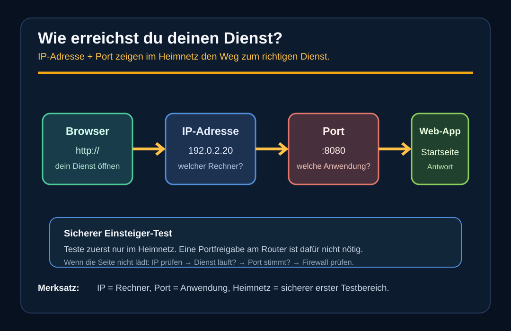

+++
title = "Vom Browser zum Dienst im Heimnetz: IP-Adresse, Port und Heimnetz für Einsteiger erklärt"
description = "Du siehst eine lokale Weboberfläche, kennst aber IP und Port nicht? Dieser Artikel erklärt, wie du einen Dienst im eigenen Netzwerk findest — ohne Portfreigabe, ohne Router-Konfiguration."
slug = "vom-browser-zum-dienst-ip-port-heimnetz"
draft = true
robotsNoIndex = true
noindex = true
preview = true
draft_banner = true
hideMeta = true
ShowShareButtons = false
ShowPostNavLinks = false
comments = false
stage = "REVIEWER_PASS_PREVIEW_VALIDATION"
preview_content_type = "article_draft"
publish_eligible = false
approved_for_publish = false
content_state = "reviewer_pass_preview_validation"
affiliate = "NONE"
source_task = "t_e51d14e1"

[sitemap]
  exclude = true

[workflow]
  content_state = "reviewer_pass"
  editorial_status = "pass"
  technical_status = "pass"
  visual_status = "pass"
  seo_status = "pass"
+++

# Vom Browser zum Dienst im Heimnetz: IP-Adresse, Port und Heimnetz für Einsteiger erklärt

**Überarbeitungsstand: 24. November 2026 | Zielgruppe: Homelab-Einsteiger mit einem laufenden lokalen Dienst**

> **Preview – noch nicht veröffentlicht.** Dieser Entwurf entstand als neutrale Erklärung für Einsteiger. Er enthält keine internen Adressen, keine Gerätekonfiguration und keinen Produkttest. Vor einer Veröffentlichung müssen die Quellverweise erneut geprüft werden; der Reviewer bestätigt, dass kein interner MATMAKSA-Lab-Wert enthalten ist.



*Bildnachweis:* Deterministische SVG-Grafik, erstellt im Rahmen des Content-Briefs `t_9fec3de1`. Keine externen Pixel oder Logos.
SHA256: `996582077bdf7b30640b8c9d8bd7af569e1b90988bf003521f9b452df1446440`

## Kurzantwort

Eine **IP-Adresse** identifiziert den Rechner im Netzwerk. Ein **Port** sagt dem Rechner, welche Anwendung die Anfrage bearbeiten soll. Die URL `http://192.168.1.50:8080` bedeutet also: „Gehe zu der Maschine mit der Adresse 192.168.1.50 und öffne dort Port 8080." Das reicht für den ersten Test komplett im Heimnetz. Eine Portfreigabe am Router ist dafür nicht nötig.

## Was ist das Heimnetz und wer ist der Router?

Dein **Heimnetz** (LAN = Local Area Network) verbindet Geräte untereinander, solange sie denselben Router oder Switch nutzen. Jeder-device bekommt dabei eine **private IP-Adresse**, zum Beispiel `192.168.178.25`. Diese Adressen gelten nur lokal; sie sind nicht direkt aus dem Internet erreichbar.

Der **Router** verbindet dein Heimnetz mit dem Internet. Er hat nach außen eine öffentliche IP-Adresse und nach innen mehrere private Adressen. Nach [Debian Handbook, Abschnitt 8.2](https://www.debian.org/doc/manuals/debian-handbook/sect.network-config) wird eine solche Schnittstelle bei DHCP-Nutzung automatisch konfiguriert; bei statischer Vergabe stehen mindestens `address`, `network`, `broadcast` und `gateway` in `/etc/network/interfaces`. Der Gateway-Wert ist genau die Adresse deines Routers im Heimnetz.

Das Debian Network Infrastructure Manual ([Kapitel 10](https://www.debian.org/doc/manuals/debian-handbook/network-infrastructure)) erklärt, dass der Gateway auch NAT (Network Address Translation) durchführt: interne Verbindungen erscheinen nach außen als Verbindung vom Router selbst. Deshalb brauchst du für lokale Tests niemals eine „Freigabe" von außen.

### Private IPv4-Bereiche (RFC 1918)

Die für Heimnetze üblichen Bereiche sind laut [Debian Reference, Kapitel 5](https://www.debian.org/doc/manuals/debian-reference/ch05):

| Bereich | Typisches Netz | Beispiele |
|---|---|---|
| `10.0.0.0` – `10.255.255.255` | Klass A | `10.0.0.5` |
| `172.16.0.0` – `172.31.255.255` | Klass B | `172.16.42.10` |
| `192.168.0.0` – `192.168.255.255` | Klass C | `192.168.178.50` |

Wenn deine Adresse in einem dieser Bereiche beginnt, bist du auf einem privaten Heimnetz – und genau hier bleiben unsere Tests.

## Die URL-Form `http://IP:PORT`

Eine vollständige URL für einen lokalen Dienst sieht so aus:

```
http://192.168.178.50:8080
```

- **`http://`** – das Protokoll. Für lokale Tests meist ausreichend.
- **`192.168.178.50`** – die IP-Adresse des Rechners, auf dem der Dienst läuft.
- **`:8080`** – der Port, also der Eingang für diese bestimmte Anwendung.

Warum lädt `http://192.168.178.50` allein nichts? Weil ein Rechner dutzende Dienste gleichzeitig betreiben kann – ein Webserver auf Port 80, eine Datenbank auf Port 5432, Pi-hole auf Port 53. Der Port teilt dem System mit, welchen Dienst die Anfrage erreichen soll. Ohne Port springt der Browser auf Standard-HTTP (Port 80); wenn dort kein Server läuft, bekommst du eine Fehlermeldung statt eines leeren Bildschirms.

Die beiden Debian-Quellen geben dir dafür keine weitere technische Tiefe vor; das Beispiel hier orientiert sich an der in [Debian Handbook, Abschnitt 8.2.1](https://www.debian.org/doc/manuals/debian-handbook/sect.network-config) gezeigten DHCP- Konfiguration, wo das Gerät nach dem Hochfahren genau eine solcher lokaler Adressen zugeteilt bekommt.

## Einzelgerät-Test und Rückweg

Du musst zunächst nur **dir selbst** vertrauen können, bevor du ein zweites Gerät fragst. Der einfachste Weg:

1. Prüfe auf dem Rechner, auf dem der Dienst läuft, seine eigene Adresse:

```bash
hostname -I
```

Notiere die erste IPv4-Adresse, z. B. `192.168.178.50`. Falls mehrere Werte erscheinen, hilft ein Blick in die Routerübersicht, welcher Wert zum Host gehört.

2. Öffne im selben Rechner einen Browser und gib ein:

```
http://127.0.0.1:8080
```

`127.0.0.1` ist die Schleifenadresse („localhost") – sie spricht immer den eigenen Rechner an. Wenn dort etwas kommt, weißt du, dass der Dienst läuft und auf diesem Port hört.

3. Wiederhole den Aufruf mit der echten lokalen Adresse:

```
http://192.168.178.50:8080
```

Wenn das klappt, ist der Dienst vom eigenen Rechner aus im LAN erreichbar. Der **Rückweg** (die Antwort) folgt automatisch dem gleichen Pfad über den Router zurück zu deinem Gerät; das regelt das Kernel-Netzwerkstack ohne zusätzliche Konfiguration.

### Zweiter Gerät-Test

Schalte nun ein zweites Gerät im selben Heimnetz an – Laptop, Tablet oder Smartphone. Stelle sicher, dass es dieselbe WLAN- oder LAN-Strecke nutzt wie der Server. Gib dann dieselbe URL ein:

```
http://192.168.178.50:8080
```

Wenn die Seite erscheint, hast du den grundlegenden Zugriff erfolgreich getestet. Notiere dir dazu drei Werte:

- die IP-Adresse des Servers
- den Port
- den Rückweg (d. h. von welchem Gerät aus du getestet hast)

Das hilft später, wenn sich die IP ändert oder ein neues Gerät dazukommt.

## Fehlerdiagnose: vier häufige Ursachen

Wenn die Seite nicht lädt, liegt das selten an einem komplizierten Problem. Gehe diese Punkte systematisch durch:

### 1. Falsche IP

Prüfe erneut `hostname -I` auf dem Server. Vergleiche mit der Geräteliste im Router. Manche Router zeigen den Hostnamen neben der IP – such nach dem Namen deines Servers. Wenn sich die IP kürzlich geändert hat (DHCP-Lease), kannst du im Router eine **DHCP-Reservierung** für die MAC-Adresse eintragen, damit der Server künftig dieselbe Adresse behält.

### 2. Dienst nicht aktiv

Auf dem Server prüfst du mit systemd, ob der Dienst läuft:

```bash
systemctl is-active <dienstname>
```

Die erwartete Ausgabe lautet `active`. Bei `inactive` oder `failed` hilft oft `systemctl status <dienstname>`, um die Ursache zu sehen. Starte danach ggf. mit `sudo systemctl start <dienstname>` und setze `enabled`, damit er beim nächsten Boot wieder hochfährt.

### 3. Falscher Port

Jeder Dienst hat einen festen Port, den er abhört. Wenn der Dienst auf `3000` hört, aber du `8080` eingibst, wirst du nichts sehen. Du kannst prüfen, welcher Port belegt ist:

```bash
ss -ltnp | grep <prozessname>
```

oder allgemein alle hörbaren Ports:

```bash
ss -ltn
```

Die Spalte `Local Address:Port` zeigt die Kombination aus IP und Port. Achte darauf, dass dort nicht nur `127.0.0.1:PORT` steht – dann lauscht der Dienst nur lokal und ist vom zweiten Gerät aus nicht erreichbar. In diesem Fall muss die Dienstkonfiguration auf `0.0.0.0` oder die tatsächliche LAN-IP umgestellt werden.

### 4. Firewall

Eine lokale Firewall kann den eingehenden Verkehr blockieren. Unter Debian kannst du den Status mit `sudo ufw status` prüfen. Falls aktiv, erlaube den entsprechenden Port, zum Beispiel:

```bash
sudo ufw allow 8080/tcp
```

Danach wiederhole den Test vom zweiten Gerät.

Wenn keiner dieser Punkte hilft, schaue in die Protokolldateien des Dienstes (`journalctl -u <dienstname>`) oder prüfe, ob der Router zwischen zwei getrennten Subnetzen unterscheidet (GästewLAN isoliert oft vom Hauptnetz).

## Warum Portfreigabe und Fernzugriff ein anderes Thema sind

Eine **Portfreigabe** (auch „Portweiterleitung" oder „DNAT") trägt am Router einen Eintrag, der eingehenden Verkehr von außen auf eine bestimmte interne IP und Port weiterleitet. Das ermöglicht Zugriff vom Internet aus – und das ist bewusst eine andere Entscheidung.

Ein Dienst, der sensible Daten verarbeitet, Passwörter verwaltet oder persönliche Inhalte bereitstellt, sollte nicht einfach per Portfreigabe ins Internet gestellt werden. Dafür gibt es gesonderte Konzepte wie VPN, Tailscale/Headscale oder reverse Proxies mit Authentifizierung. Der aktuelle Artikel beschränkt sich auf den lokalen Test.

[Debian Network Infrastructure](https://www.debian.org/doc/manuals/debian-handbook/network-infrastructure) erläutert NAT und Destination-NAT (DNAT) technisch: DNAT ändert die Zieladresse eingehender Pakete, was genau das macht, was eine Portfreigabe bewirkt. Der Artikel erwähnt diesen Mechanismus als Information, nicht als Handlungsanleitung.

### Faustregel

> Solange du nur im eigenen Heimnetz arbeitest, brauchst du keine Portfreigabe. Öffne einen Dienst erst dann nach außen, wenn du die Folgen kennst – verschlüsselten Zugang, Authentifizierung und eine klare Schadensabwehr.

## FAQ

### Muss ich dem Dienst eine feste IP geben?

Nicht zwingend. DHCP vergibt zwar manchmal wechselnde Adressen, aber für den Einstieg reicht der Router-Diagnosebildschirm, um die aktuelle IP abzulesen. Soll die Adresse dauerhaft gleich bleiben, trägst du im Router eine DHCP-Reservierung für die MAC-Adresse des Servers ein.

### Funktioniert die gleiche URL auch über den Hostnamen?

Oft ja. Wenn dein Router oder lokal instalierter DNS-Server (z. B. Pi-hole) den Hostnamen des Servers auflöst, kannst du statt der numerischen IP auch `http://meinserver.local:8080` probieren. Das erfordert jedoch eine funktionierende Namensauflösung im LAN; die IP-Adresse funktioniert immer, sobald das Paket den richtigen Empfänger erreicht.

### Kann ich HTTPS verwenden?

Ja. HTTPS verschlüsselt die Verbindung zwischen Browser und Dienst. Für reine Heimnetztests ist HTTP zunächst ausreichend, weil das Zertifikat sonst eine vertrauenswürdige CA benötigt oder du Ausnahmen im Browser akzeptieren musst. Sobald der Dienst auch von außerhalb erreichbar sein soll, wird HTTPS zur Voraussetzung.

### Was ist der Unterschied zwischen DNS und der IP-Adresse?

DNS ist ein Telefonbuch: Es übersetzt menschenlesbare Namen (`meinsvr.lan`) in Zahlen (`192.168.178.50`). Für den lokalen Test brauchst du die Zahl direkt, sobald kein lokaler DNS-Server eingerichtet ist. Für die tägliche Arbeit empfiehlt sich ein Eintrag im Router oder ein eigener Resolver, damit du nicht jede Adresse notieren musst.

## Das solltest du jetzt können

- [ ] Den Unterschied zwischen IP-Adresse (Rechner) und Port (Anwendung) erklären
- [ ] Die eigene LAN-Adresse mit `hostname -I` ablesen
- [ ] Einen lokalen Dienst über `http://IP:PORT` vom eigenen Gerät und von einem zweiten Gerät testen
- [ ] Vier typische Fehlerursachen systematisch prüfen
- [ ] Begründen, warum kein Router-Eingriff für den lokalen Test nötig ist

## Quellen

- [Debian Handbook – Configuring the Network](https://www.debian.org/doc/manuals/debian-handbook/sect.network-config)
- [Debian Handbook – Network Infrastructure](https://www.debian.org/doc/manuals/debian-handbook/network-infrastructure)
- [Debian Reference – Chapter 5: Network setup](https://www.debian.org/doc/manuals/debian-reference/ch05)

## Quellenmatrix

| Behauptung | Quelle | Prüfung |
|---|---|---|
| Private IP-Bereiche (RFC 1918) gelten für Heimnetze | Debian Reference Kap. 5 | Quelle geöffnet 2026-11-24; Abschnitt 5.1 listet die privaten Netze explizit |
| DHCP- vs. statische Konfiguration in `/etc/network/interfaces` | Debian Handbook §8.2 | Quelle geöffnet 2026-11-24; Beispiele 8.1 und 8.2 bestätigen Syntax |
| Gateway/NAT/Masquerading wird vom Router übernommen | Debian Handbook Kap. 10 | Quelle geöffnet 2026-11-24; Abschnitt 10.1 beschreibt Source-NAT und Masquerading |
| DNAT (Destination-NAT) ist die Technik hinter Portfreigaben | Debian Handbook Kap. 10 | Quelle geöffnet 2026-11-24; Abschnitt 10.1 nennt DNAT als „alter destination IP address … incoming connection" |
| Lokale Tests benötigen keine Router-Änderung | Debian Handbook §8.2 + Kap. 10 | Ableitung aus der Beschreibung, dass interne Pakete über Gateway geroutet werden und NAT nur den Weg nach außen betrifft |

## Bildnachweis

| Feld | Wert |
|---|---|
| Datei | `grafiken/02-ip-port-heimnetz.svg` |
| Pfad im Workspace | `/root/.hermes/kanban/workspaces/t_9fec3de1/grafiken/02-ip-port-heimnetz.svg` |
| SHA256 | `996582077bdf7b30640b8c9d8bd7af569e1b90988bf003521f9b452df1446440` |
| Alttext | Flussdiagramm: Browser nutzt IP-Adresse für den Rechner und Port für die Webanwendung; der erste Test bleibt im Heimnetz. |
| Herkunft | Eigene deterministische SVG-Erstellung im Briefing-Workspace `t_9fec3de1`; keine externen Pixel, keine Logos |
| Visual check | Im Briefing geladen über Chromium `file://`; Renderbarkeit, Kontrast, Beschriftung und Diagrammstruktur visuell bestätigt |
| Lizenz | Eigencreated, keine externe Lizenz erforderlich |
